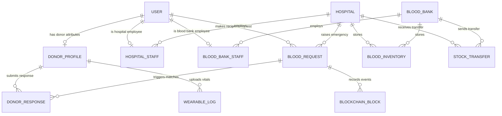
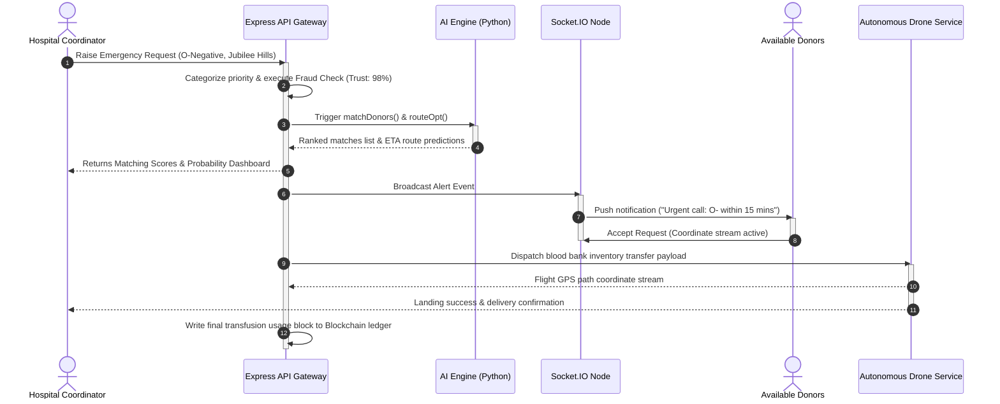
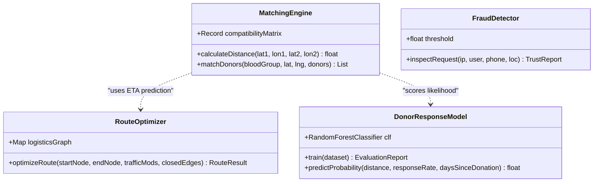
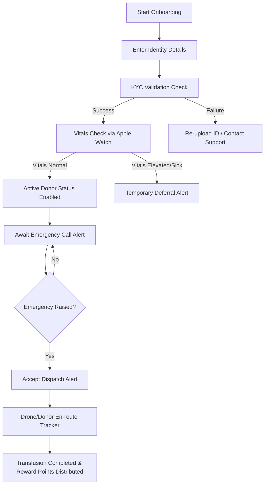

# BloodLink AI - System Architecture & UML Diagrams

This document outlines the technical architecture, data structures, workflows, and diagrams for the **BloodLink AI** national healthcare infrastructure.

---

## 1. System Architecture Diagram
The platform is designed as a secure, containerized multi-tier microservice architecture. 

```mermaid
graph TD
    %% Tiers
    subgraph Client Tier (Web Apps)
        A["React Dashboard (SPA)"]
        B["iOS/Android (React Native)"]
    end

    subgraph API Gateway & Service Tier
        C["Express.js Web Server"]
        D["Socket.io WebSocket Node"]
    end

    subgraph AI/ML Processing Container
        E["Python ML Daemon (Flask/FastAPI)"]
        F["RandomForest & XGBoost Predictors"]
    end

    subgraph Data & Storage Layer
        G[("PostgreSQL DB (Prisma Client)")]
        H[("IPFS / Ledger Database")]
    end

    %% Client Interactions
    A -->|REST API Requests| C
    A <-->|Real-time streams| D
    B -->|REST API Requests| C
    B <-->|Biometrics Sync| D

    %% Server Internal
    C -->|gRPC / REST calls| E
    E -->|Loads Models| F
    C -->|Query / Mutate| G
    C -->|Publish Blocks| H
```

---

## 2. Entity Relationship Diagram (ERD)
The schema is modeled with relational constraints matching standard healthcare directory standards.



---

## 3. UML Sequence Diagram: Emergency Matching & Dispatch
This sequence details the interactions when a clinical user raises an urgent whole blood request.



---

## 4. UML Class Diagram
The software classes modeling the AI Logistics services.



---

## 5. User Flow Diagrams
Onboarding and Emergency Response loops.


